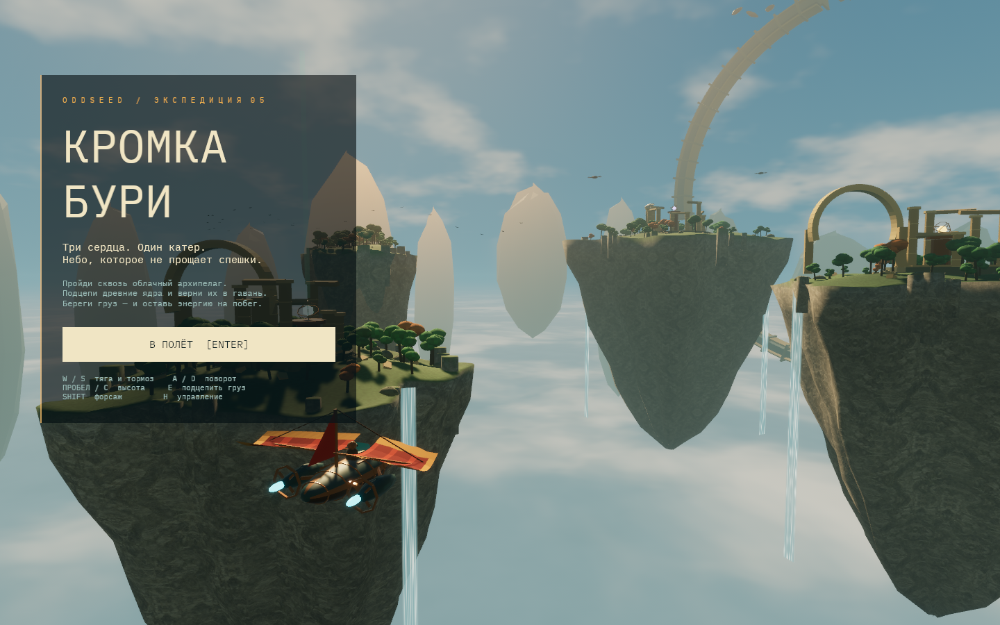

# Кромка бури / Storm Edge

[](https://github.com/OddseedGames/storm-edge/actions/workflows/ci.yml)

[Играть в браузере](https://oddseedgames.github.io/storm-edge/) · [Репозиторий](https://github.com/OddseedGames/storm-edge)

Трёхмерная экспедиция на летающем катере: подцепить три древних ядра, вывезти их через облачный архипелаг и доставить в гавань. Rust + Bevy, камера от третьего лица, инерция, ветер и физический груз на тросе.

Первая играбельная версия содержит законченный маршрут с тремя доставками, охотников, импульсную пушку, щит, повреждения, поражение, победу и перезапуск. Это короткий игровой срез; развитие гавани и большая кампания остаются дальнейшим развитием.



## Запуск

Нативная версия:

```sh
sh scripts/run.sh
```

Локальная веб-версия после сборки:

```sh
sh scripts/build-web.sh
python3 scripts/serve.py --port 8085
```

Открыть <http://localhost:8085> в Chrome с аппаратным ускорением и WebGPU. Для уже собранной версии достаточно команды сервера. Веб-версия загружает ассеты из каталога `dist/assets-<hash>`; интернет во время локальной игры не требуется. Первый запуск браузерной версии загружает около 50 МБ ресурсов до сжатия.

Зафиксированы Rust 1.99.1 и Bevy 0.19.0; версии внутренних библиотек записаны в Cargo.lock. Для веб-сборки нужен target `wasm32-unknown-unknown` и wasm-bindgen-cli **0.2.129**, соответствующий Cargo.lock:

```sh
rustup target add wasm32-unknown-unknown
cargo install wasm-bindgen-cli --version 0.2.129 --locked
```

Скрипты автоматически используют Rust из соседней `.tools`, если он уже установлен для остальных игр.

## Управление

| Клавиша | Действие |
| --- | --- |
| Enter / кнопка меню | Начать / продолжить |
| W | Полная тяга |
| S | Воздушный тормоз |
| A / D | Поворот влево / вправо с креном |
| Пробел / C | Набор высоты / снижение |
| Стрелки | Поворот и изменение высоты |
| Shift | Форсаж |
| Ctrl | Щит |
| F / левая кнопка мыши | Импульсная пушка |
| E | Подцепить ядро / сдать груз в гавани |
| Q / Z | Укоротить / удлинить трос |
| X | Оставить груз на аварийном поплавке |
| H | Помощь с остановкой симуляции |
| Esc | Пауза |
| R на паузе или после окончания | Новая экспедиция |
| M | Звук |
| P | Скрыть интерфейс для фотографии |
| F2 | Полное / экономичное качество графики |
| F12 в нативной версии | Сохранить скриншот |

Без W катер поддерживает крейсерскую тягу. Для подхвата нужно оказаться рядом с маяком и снизить скорость; для сдачи вернуться в светящееся кольцо гавани и нажать E. Доставка восстанавливает часть корпуса и всю энергию.

Форсаж, пушка и щит расходуют общую батарею. Батарея восстанавливается при выключенных форсаже и щите. Форсаж оставляет заметный тепловой след; за островами можно разорвать видимость со стражами. Щит помогает пережить залп, форсаж — увеличить дистанцию.

## Физика и графика

- Фиксированный шаг 120 Гц. Тяга, квадратичное сопротивление, подъёмная сила, боковое демпфирование, автоматическая стабилизация, порывы ветра и восходящий поток.
- Масса катера 320 кг; грузы 70, 105 и 145 кг. Ограничение длины троса двустороннее: импульс груза передаётся катеру. Длина меняется от 3,5 до 12 м.
- Коллизии рельефа, колонн, арок и основных частей гавани. Катер и груз проверяются отдельно.
- Процедурные острова, деревья, руины и детальная модель катера. Крылья колышутся, винты вращаются, на виражах остаются следы.
- PBR, тени солнца, освещение от окружения, bloom, воздушная перспектива, объёмный туман, анимированные облака и водопады.
- Камень проецируется по трём мировым осям; случайное смешивание образцов скрывает повторение. Мох зависит от уклона поверхности. Mip-уровни и анизотропная фильтрация уменьшают мерцание вдали.
- Сцена рисуется в отдельную текстуру шириной до 1600 пикселей; интерфейс сохраняет разрешение окна. Экономичный режим уменьшает разрешение сцены и отключает объёмный туман и тени.

Физика рассчитана на доступный полёт с автоматической стабилизацией. Крупное кольцо на горизонте и дальние скалы — декорации.

## Модули

| Каталог | Ответственность |
| --- | --- |
| `src/flight/` | Независимые расчёты полёта, троса и ветра |
| `src/game/` | Миссия, управление, фиксированный шаг, стражи и импульсы |
| `src/level.rs`, `src/level/` | Координаты, форма островов и коллизии архитектуры |
| `src/graphics/` | Генерация мешей, материалы, катер, камера, освещение и эффекты |
| `src/ui/` | Меню, приборы, маркеры и обработка кнопок |
| `src/audio.rs` | Звук ветра и двигателя |
| `src/browser.rs` | Телеметрия для браузерных проверок |
| `assets/shaders/` | WGSL-шейдеры атмосферы и камня |

`main.rs` только запускает приложение. Расчёты полёта и логика миссии доступны из библиотеки и проверяются без окна и GPU.

## Проверки

```sh
sh scripts/check.sh
```

Проверяются форматирование, Rust-тесты и компиляция WASM. Тесты охватывают направления поворотов и крена, разгон, торможение, энергию, сохранение импульса в тросе, коллизии, замкнутость оболочки островов, паузу и полный физический маршрут с тремя доставками.

`tests/browser-smoke.js` — сценарий для браузерной проверки. Он подаёт обычные клавиатурные события, читает скрытую телеметрию, проверяет меню и управление и проходит маршрут небольшими отрезками. Изменения состояния игры в обход управления не используются.

## CI и публикация

[GitHub Actions](https://github.com/OddseedGames/storm-edge/actions/workflows/ci.yml) запускается при push в `main`, для pull request и вручную:

- Linux и Windows: форматирование, сборка и все 18 Rust-тестов. Профиль `ci` отключает оптимизацию зависимостей для быстрой проверки без окна и GPU.
- WASM: сборка с зафиксированными Rust и wasm-bindgen, удаление отладочного раздела имён, упаковка всех ресурсов, проверка контрольных сумм, ссылок загрузчика и размера файлов.
- Готовый каталог сайта сохраняется как артефакт `storm-edge-web` на 14 дней. Для локального запуска скачанного артефакта нужен HTTP-сервер.
- GitHub Pages публикуется из `main` только после успешных тестов и веб-сборки. Pull request не запускает деплой.

JavaScript и WASM загружаются с версией по SHA-256, ресурсы получают отдельный каталог по хешу содержимого. `build.json` содержит версию сборки, SHA коммита CI и контрольные суммы файлов. Проверить собранный сайт отдельно:

```sh
python3 scripts/verify-web.py dist
```

CI проверяет код и пакет без GPU. Визуальную проверку WebGPU и сценарий браузерного управления выполняют отдельно в Chrome.

Схема публикации использует [официальный workflow GitHub Pages](https://docs.github.com/en/pages/getting-started-with-github-pages/using-custom-workflows-with-github-pages). Настройка репозитория Pages: источник `GitHub Actions`.

## Ассеты

Геометрия, шейдеры и синтезированный звук созданы для проекта. Звук воспроизводится заново командой `python3 scripts/generate-audio.py`.

IBM Plex Mono: SIL Open Font License, текст лицензии в `assets/fonts/OFL.txt`.

Текстура `assets/textures/weathered-rock.png` создана встроенным imagegen. [Промпт и происхождение](assets/textures/PROVENANCE.md). Код и визуальные материалы проекта подготовлены с помощью AI.
